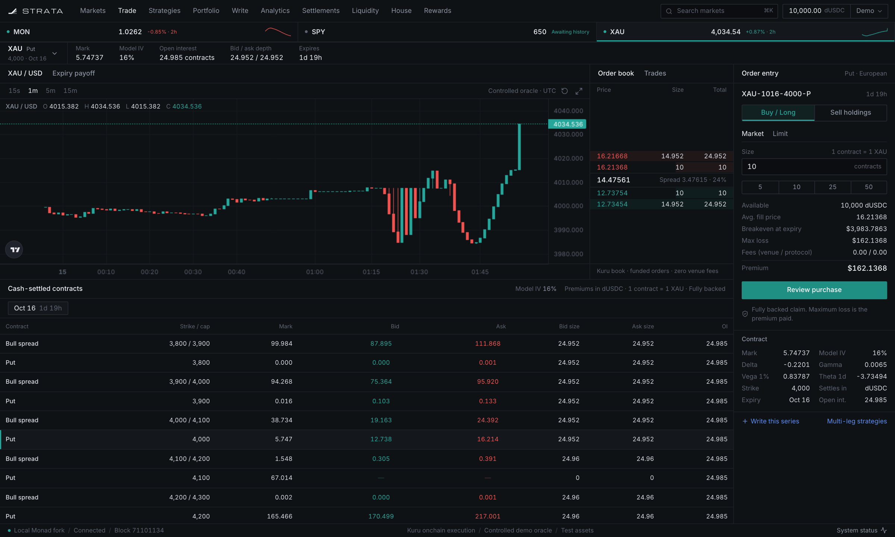
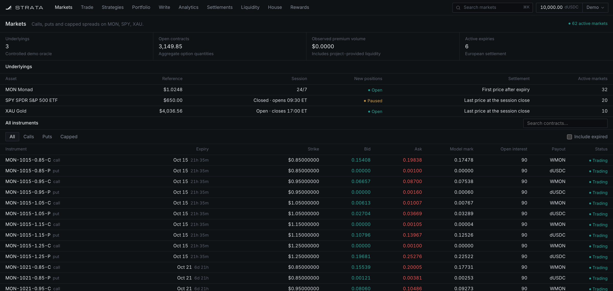
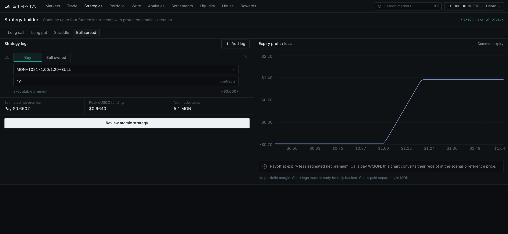
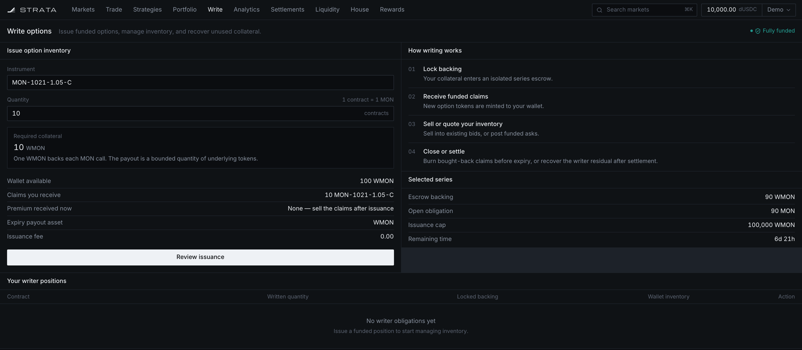
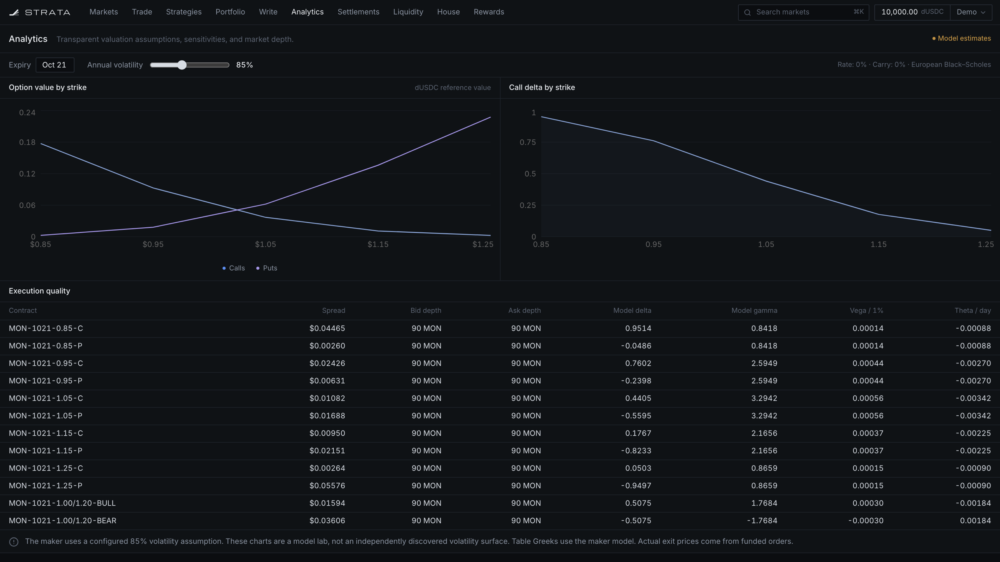
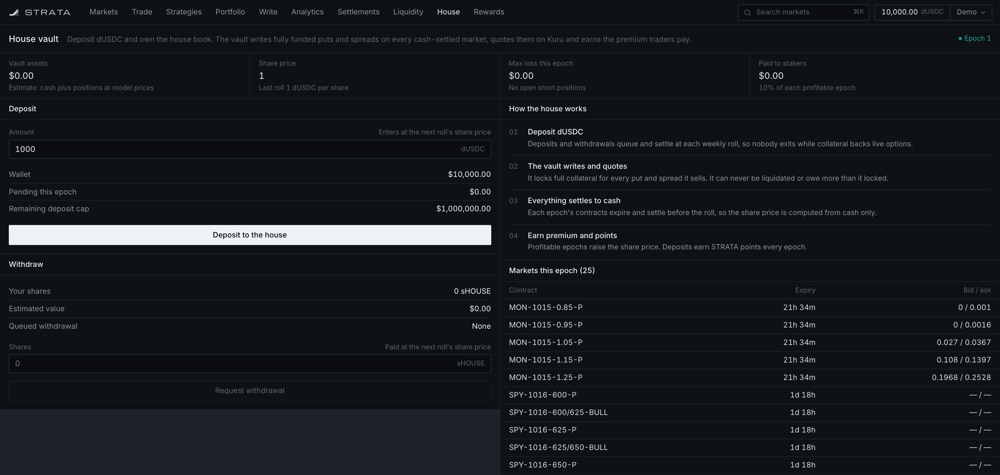
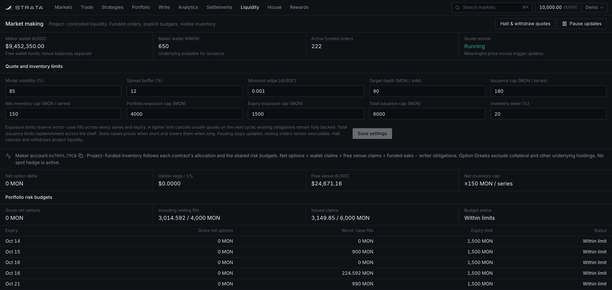
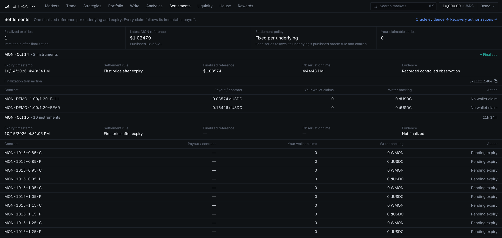
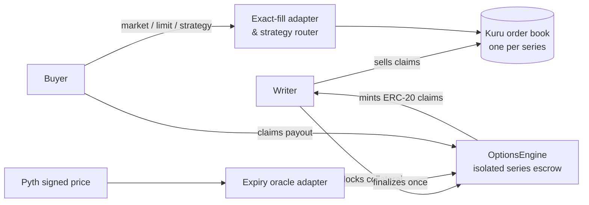

<div align="center">


# Strata

**A fully funded options exchange on Monad.**

European calls, puts and capped spreads that trade on Kuru's onchain order books and settle against authenticated Pyth prices. No margin, no liquidations, no naked shorts.

[**Live demo**](https://strata-xyz.vercel.app) · [Architecture](docs/architecture.md) · [Testnet deployment](docs/testnet-demo.md) · [Operations reference](docs/reference.md)


<br />



</div>

## Why Strata

Most onchain options venues either lock liquidity in an AMM or ask writers to post margin that can be liquidated. Strata takes the simpler route: **every option is a fully collateralized ERC-20 claim**, and those claims trade on existing onchain order books. A buyer's worst case is the premium. A writer's worst case is the collateral they already locked. Payouts can't fail because one party disappears.

## Features

|                              |                                                                                                                                                                                  |
| ---------------------------- | -------------------------------------------------------------------------------------------------------------------------------------------------------------------------------- |
| **Fully funded instruments** | Calls backed 1:1 by WMON, puts by their full strike in dUSDC, capped bull/bear spreads by their maximum payout. Per-series escrow stays solvent whatever order claims arrive in. |
| **Onchain order books**      | Every series is its own Kuru market. Market and post-only limit orders against funded depth, with zero venue fees.                                                               |
| **Atomic strategies**        | Combine up to four legs (straddles, spreads, custom) through an exact-fill router. Every leg fills completely within its budget, or the whole transaction reverts.               |
| **Authenticated settlement** | Each expiry finalizes once, against a signed Pyth observation. The price, confidence, timestamp and payload hash are stored onchain, and no later price can replace them.        |
| **13 assets**                | MON, BTC, ETH, SOL, XRP, DOGE, BNB, HYPE, QQQ, TSLA, gold, silver and EUR/USD. Scheduled markets follow their Pyth trading sessions.                                             |
| **House vault**              | Deposit dUSDC into a pooled writer that quotes every cash-settled market and rolls weekly. Shares are priced from settled cash only, with no model marks.                        |
| **Points & STRATA**          | Vault deposits and losses paid to the house earn points. Points become STRATA, and staked STRATA earns the vault's 10% performance fee.                                          |
| **Self-custody recovery**    | Signed delegated claims, bilateral unwinds for unresolved expiries, and one-click revocation of pending authorizations. Supports EOA, EIP-7702 and ERC-1271 wallets.             |
| **Funded market maker**      | Black–Scholes quote ladders with inventory skew, per-series and per-expiry risk budgets, and a halt switch that cancels quotes and withdraws venue funds.                        |
| **Verifiable deployment**    | The engine and all 27 exact-fill adapters have exact bytecode matches on [Sourcify](https://repo.sourcify.dev/10143/0x4295487dcD487f9720a6d7b0Cd9d15645cF9745C).                 |

## Tour

<table>
  <tr>
    <td width="50%"></td>
    <td width="50%"></td>
  </tr>
  <tr>
    <td><b>Markets</b>: every listed instrument with live bid/ask, model mark, open interest and settlement asset.</td>
    <td><b>Strategy builder</b>: preset or custom multi-leg positions with an expiry P&amp;L curve and atomic execution.</td>
  </tr>
  <tr>
    <td></td>
    <td></td>
  </tr>
  <tr>
    <td><b>Write</b>: lock collateral, mint claims and sell them. Burn bought-back claims to release backing early.</td>
    <td><b>Analytics</b>: value and delta by strike, plus spread, depth and Greeks for every contract.</td>
  </tr>
  <tr>
    <td></td>
    <td></td>
  </tr>
  <tr>
    <td><b>House vault</b>: deposit, withdraw and see what the vault is quoting this epoch.</td>
    <td><b>Liquidity</b>: maker risk limits, inventory, risk budgets per expiry and book coverage.</td>
  </tr>
  <tr>
    <td colspan="2"></td>
  </tr>
  <tr>
    <td colspan="2"><b>Settlements</b>: one immutable reference per underlying and expiry, with payouts, claims, oracle evidence and recovery flows.</td>
  </tr>
</table>

## How it works



| Instrument    | Writer locks                         | Holder receives at expiry      |
| ------------- | ------------------------------------ | ------------------------------ |
| Call          | 1 WMON per contract                  | `qty × (S − K) / S` in WMON    |
| Put           | `qty × K` in dUSDC                   | `qty × max(K − S, 0)` in dUSDC |
| Capped spread | Maximum strike-width payout in dUSDC | Spread payoff in dUSDC, capped |

Funding and writer obligations round up, and holder payouts round down, so fractional claims can never drain an escrow. Offchain services (indexer, pricing, maker and keeper workers) never sit between a holder and their payout.

## Live on Monad testnet

Open **[strata-xyz.vercel.app](https://strata-xyz.vercel.app)**, connect a wallet on Monad testnet (chain `10143`), grab dUSDC from the faucet in the account menu, and start with 0.1 contracts. All quotes are project-funded test liquidity.

| Contract         | Address                                                                                                                    |
| ---------------- | -------------------------------------------------------------------------------------------------------------------------- |
| Options engine   | [`0x4295487dcD487f9720a6d7b0Cd9d15645cF9745C`](https://repo.sourcify.dev/10143/0x4295487dcD487f9720a6d7b0Cd9d15645cF9745C) |
| Strategy router  | `0xb32F444cFA93EC088548ac5996b276648d501aAd`                                                                               |
| Oracle router    | `0x41F93DB8cF7A00920139222883e5822B9dFCeEA1`                                                                               |
| House vault      | `0x4E6537315026f2Fb85857B38A1dFe749F47bC683`                                                                               |
| STRATA / staking | `0xd04fDfDC43368dEaC6379D6826E86C4C3fC85335` / `0x49Addcce2346b6598D167A706fbCd0B51e0D7bc6`                                |

The full address list, verified receipts and hosting setup are in the [testnet runbook](docs/testnet-demo.md).

## Run it locally

You need Node.js 25 (see `.nvmrc`), npm, and [Foundry](https://getfoundry.sh) (`forge`, `cast`, `anvil`). No keys or funded accounts are required.

```sh
npm ci
npm run setup      # pin forge-std, compile contracts
npm run local:up   # fork Monad testnet, deploy + seed, start API and terminal
```

Open **http://localhost:5173**. The first seed takes a few minutes. It deploys the protocol on an Anvil fork (chain `31337`) against the real Kuru contracts and funds a maker and a demo account.

## Testing

```sh
npm run check      # typecheck, unit + service tests, Foundry suite, web build
npm run test:e2e   # Playwright: real local transactions through the UI
```

The Foundry suite covers lifecycle, rounding, fuzzing, signatures, the Pyth adapter, the house vault and STRATA. The Playwright suite drives multi-level fills, strategies, writing and burning, maker controls, settlement payouts, relayed claims and unwinds against a live local chain, then restores it from a checkpoint afterwards.

## Repository

```
contracts/        Solidity: options engine, claim tokens, oracle adapters, Kuru adapter, router, house vault, STRATA
packages/core/    Pricing, Greeks, maker ladders, points, house epochs, evidence parsing
apps/api/         Fastify API, SQLite/Supabase read model, maker, keeper and house workers
apps/web/         React terminal, wallet flows, TradingView Lightweight Charts
scripts/          Local setup and seeding, deployment packages, testnet operations, Pyth checks
tests/            Playwright end-to-end suites
```

## Documentation

- [Architecture](docs/architecture.md): design decisions and the alternatives considered
- [Operations reference](docs/reference.md): collateral, execution, readiness, recovery and receipts in depth
- [House vault](docs/house-vault.md): epochs, trust model, points and endpoints
- [Oracle operations](docs/oracle-operations.md) · [Multi-asset oracles](docs/multi-asset-oracles.md)
- [Deployment operations](docs/deployment-operations.md) · [Testnet demo](docs/testnet-demo.md)
- [Implementation ledger](docs/implementation.md)

<br />

> [!NOTE]
> Strata is a testnet project. Its contracts have not been externally audited, its liquidity is project-funded, and dUSDC is a test token. Don't use it with real funds.
