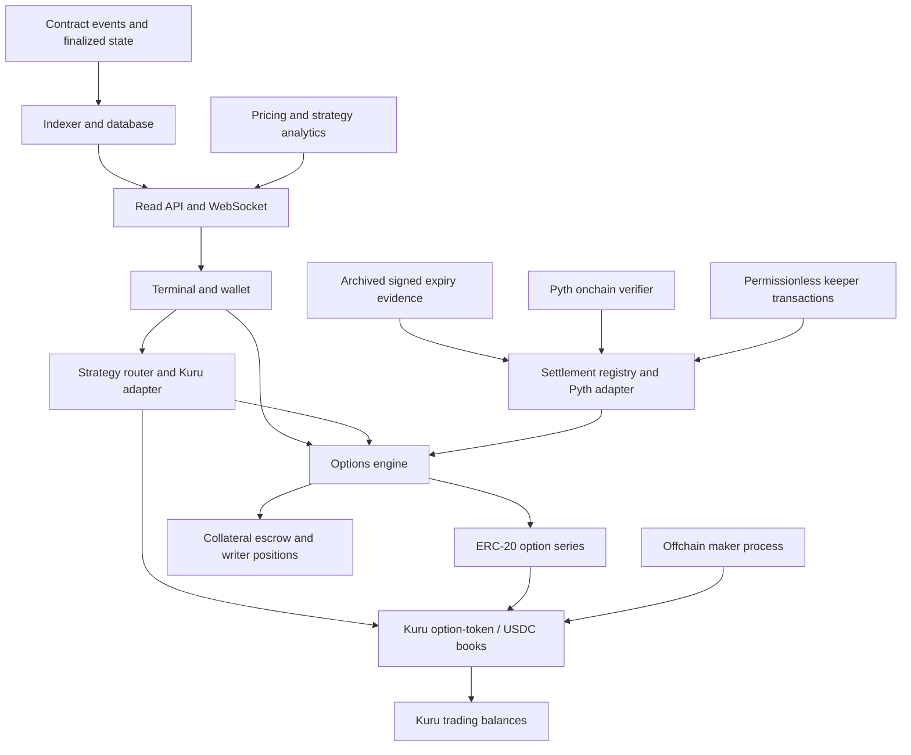

# Monad options platform: recommended architecture

**Decision date:** 11 October 2026 — revision 2\
**Status:** Target architecture with a working local implementation. Funded instruments, Kuru execution on a local Monad fork, connected UI and local maker/keeper workflows are implemented and tested. Authentic Pyth proof admission, public deployment and external security review remain open. See [the implementation ledger](implementation.md) for evidence and remaining gates.\
**Audience:** Product, engineering and hackathon reviewers.\
**Team assumption:** One or two builders.\
**Objective:** A technically credible, substantial options platform with a strong Monad demonstration and a plausible path to customers.

## 1. The decision

Build a **hybrid options platform with isolated, fully funded European option claims, Kuru onchain order books, proof-based expiry settlement, and offchain analytics and maker services**. Support vanilla calls/puts first and a small set of native USDC-settled capped spreads after the core lifecycle passes its gates.

The core choices are:

| Question                              | Decision                                                                                                                                                                                                                                                                           |
| ------------------------------------- | ---------------------------------------------------------------------------------------------------------------------------------------------------------------------------------------------------------------------------------------------------------------------------------- |
| What instruments?                     | Vanilla European calls/puts, plus curated native capped spreads. A spread token is one bounded claim, distinct from a strategy holding two vanilla tokens.                                                                                                                         |
| How are writers funded?               | Vanilla calls backed by underlying; vanilla puts backed by their full strike notional in USDC; native spreads backed by their full payout cap in USDC. No naked shorts.                                                                                                            |
| What do buyers receive at expiry?     | Vanilla calls pay the underlying; vanilla puts and native capped spreads pay USDC. All premiums quote in USDC.                                                                                                                                                                     |
| Where do orders execute?              | Existing Kuru onchain books: one option-token/USDC market per listed series.                                                                                                                                                                                                       |
| What do we build ourselves?           | Options issuance, collateral escrow, position accounting, expiry settlement, the execution adapter/strategy router, and the complete terminal.                                                                                                                                     |
| What runs offchain?                   | Indexing, live APIs, pricing models, Greeks, volatility surfaces, strategy analysis, maker bots and keeper transaction submission.                                                                                                                                                 |
| First live asset family?              | MON: WMON-backed calls and USDC-backed puts. Other assets are staged additions.                                                                                                                                                                                                    |
| Expiry reference?                     | Prefer Pyth Core's unique first update at/after expiry, verified onchain with `parsePriceFeedUpdatesUnique`. Admission requires a complete signed-proof test on the chosen deployment. Chainlink is a monitoring comparison, not a caller-selectable alternative settlement price. |
| How do we improve capital efficiency? | Fund native capped claims by their maximum possible payout; recover unsold vanilla inventory by burning; support protected buyback/roll workflows. Do not release vanilla collateral merely because a portfolio looks hedged.                                                      |
| How do we address liquidity?          | A small canonical shelf, funded makers, explicit depth targets and listing gates. No automatic creation of every strike/expiry/spread combination.                                                                                                                                 |
| What is deliberately deferred?        | Portfolio margin, unsecured shorts, liquidations, collateral lending, automatic pooled LP vaults and arbitrary RWA listings.                                                                                                                                                       |

Vanilla calls remain available: their dollar payoff can be uncapped while their token payout is bounded by deposited underlying. Native capped products add a genuinely cheaper funding path for users who accept capped upside. They do not turn an unsecured vanilla call into a funded one.

The recommendation is based on researched interfaces and mechanisms. Kuru execution has passed deployed-contract tests on a local Monad fork; public deployment reconciliation and authentic Pyth historical proof verification remain acceptance gates. If a gate fails, do not advertise that route as operational or silently change existing instruments.

### What revision 2 improves

| Earlier weakness                           | Revised mechanism                                                                               | Remaining limitation                                                                           |
| ------------------------------------------ | ----------------------------------------------------------------------------------------------- | ---------------------------------------------------------------------------------------------- |
| Every strategy funds a whole vanilla short | Native bounded spread claims require only the full payout cap                                   | Different instrument; vanilla portfolio margin remains absent                                  |
| Too many empty books                       | Demand-led listing, canonical recipes, maker depth/uptime targets                               | Makers and customers must still be recruited                                                   |
| Custom oracle round/phase traversal        | Provider-verified first-update proof; archived payloads; permissionless finalization            | Oracle truth, verifier upgrades and proof availability remain dependencies                     |
| Wallet/exchange/escrow confusion           | One portfolio with explicit available, reserved and locked balances; wallet delivery by default | Resting orders still depend on venue custody                                                   |
| Unknown exact fills and withdrawals        | Deployment manifest, precision matrix, pause/upgrade drills and hard activation gates           | Existing Kuru audits do not validate this integration                                          |
| Weak emergency handling                    | Direct claim paths, opt-in delegated claims and bilateral unwind while unresolved               | No unilateral fair cash payout can be inferred when all external price evidence is unavailable |

The goal is a smaller financial correctness surface and better actual usability. There is no architecture that guarantees liquidity, accurate external prices, all-audience suitability and high capital efficiency at once.

## 2. Why this is the best starting point

The platform should feel like an actual options venue: a familiar chain of strikes and expiries, useful strategies, a writer workspace, trading depth, portfolio exposure and observable settlement. Tokenizing vanilla instruments supports that naturally.

A one-to-two-person team should spend its engineering effort on the options-specific system. Writing another general order-book engine would add custody, matching, cancellation and gas-optimization work before the options product exists. Kuru exposes onchain markets for existing ERC-20 tokens, so an option claim can be the base asset and USDC the quote asset. Its deployment documentation and public contracts support this integration direction. [R1, R2]

Full funding makes issuance and settlement depend on funded obligations rather than constantly estimated liquidation thresholds. Native bounded claims improve funding efficiency within that model. The design still cannot match an established portfolio-margin venue's complete professional feature set.

Offchain analytics enable a sophisticated terminal without making model correctness a prerequisite for paying claims. A Black-Scholes estimate can be wrong without changing a contract's expiry payoff.

### Alternatives considered

| Alternative                                                            | Strength                                                                                    | Reason it is not the first architecture                                                                                                                                   |
| ---------------------------------------------------------------------- | ------------------------------------------------------------------------------------------- | ------------------------------------------------------------------------------------------------------------------------------------------------------------------------- |
| USDC-backed capped spreads only                                        | Compact payout math and finite stablecoin funding                                           | Too restrictive alone. Include a small native capped product set alongside the vanilla core.                                                                              |
| Fully funded vanilla and native capped claims + existing onchain books | Familiar options, efficient bounded products, reusable execution and genuine Monad activity | **Selected.** Vanilla capital requirements, mixed settlement currencies and venue dependency remain.                                                                      |
| USDC-settled naked options with portfolio margin                       | Professional capital efficiency and broad trading flexibility                               | Requires mark-price policy, margin stress models, liquidations, auction liquidity and insolvency handling. Too much unvalidated financial machinery for this first build. |
| Options AMM or public pooled underwriting vault                        | A direct route to passive liquidity                                                         | Requires underwriting policy, inventory pricing, withdrawal restrictions and loss allocation. A pool is not automatically a viable options market maker.                  |
| Private matching engine with onchain settlement                        | Easier to create a responsive matching service                                              | Adds an ordering/availability dependency and weakens the fully onchain market demonstration when Kuru already provides execution.                                         |
| RFQ-only venue                                                         | Useful for complete strategy packages and thin markets                                      | Dealer availability remains necessary. Keep initial executable orders on Kuru; any later RFQ route needs its own authorization, funding and track-eligibility review.     |
| Oracle-free perpetual options                                          | Interesting composability and different market mechanics                                    | Changes the product from fixed-expiry vanilla options and introduces another difficult pricing model.                                                                     |
| A Hyperliquid-style custom chain engine                                | Specialized exchange execution                                                              | Outside this project. HyperCore is consensus-executed native chain machinery, not a Solidity library we can deploy on Monad. [R3]                                         |

These judgments are engineering and product assessments. They are not measured probabilities of winning. Atomic spreads, covered calls and tokenized options already exist elsewhere; our case must be execution quality, ecosystem integration and a convincing end-to-end product.

## 3. Product and startup thesis

The initial customer hypothesis is **Monad token holders, treasuries and active traders who want options exposure, downside protection, or covered-call income without an unsecured leveraged account**.

There are three connected workflows:

1. **Trader:** Buy a call or put, resell it before expiry, or execute several instruments as one strategy.
2. **Writer:** Deposit WMON or USDC, issue funded options, sell the claims and manage the resulting obligation.
3. **Maker:** Hold funded option inventory, quote bids and asks across selected series, and update those quotes in batches.

The first useful market is MON itself. That supplies a Monad-specific reason for the product and avoids making bridged assets or gold the initial correctness dependency. The architecture can expand to other assets after validating their tokens and feeds.

A full terminal is justified by these workflows. The chain, strategy builder, portfolio, writer console, maker tools and settlement explorer all describe the same real contracts and balances.

### Business model

Use a configurable issuance fee, charged separately from collateral, and optionally an explicit strategy-routing fee. Model issuance fees as a small percentage of the funding asset; testnet defaults can be zero. Exact commercial rates require customer and maker feedback.

Keep initial maker economics measurable: a collateral-based issuance fee can overwhelm a cheap premium and repeatedly charge idle inventory that gets burned/reissued. Default early demonstrations to zero protocol fees, show venue/gas costs, and test the commercial fee against actual premium turnover, funding time and maker net returns. New fee schedules apply only to new series terms. Zero-fee usage is not evidence that fee-paying usage will persist.

Kuru venue fees are separate. Do not assume they belong to us or that an integrator can automatically collect them. A routing fee can be bypassed by users trading directly; issuance fees are enforceable where new liabilities are created. Premium analytics or APIs are a later revenue hypothesis.

The largest business uncertainty is demand and maker participation. The implementation should support recruiting a maker and testing actual funded quoting. More pages, synthetic volume or a fitted volatility surface do not establish product-market fit.

## 4. Instrument specification

### 4.1 Terms of one series

A series is fixed by:

- Underlying/reference asset and its exact collateral token.
- Vanilla call, vanilla put, native bull-call spread or native bear-put spread.
- One strike, or ordered lower/upper strikes for a native spread, in the documented quote unit.
- Expiry timestamp.
- Option-token address and quantity convention.
- Collateral and payout asset.
- Oracle verifier, feed ID, normalization bounds and immutable settlement-policy version.
- Fee terms, market parameters and the registered Kuru market.

Economic terms cannot be edited after issuance. Changing a feed policy or strike creates a new series/policy version. Initially list a small curated set of strikes and expiries rather than fragmenting liquidity across hundreds of empty books.

### 4.2 Calls: underlying-backed and underlying-settled

Let:

- `q` = underlying quantity represented by the option position;
- `K` = strike;
- `S` = finalized reference price.

The buyer receives:

```text
callTokenPayout = q × max(S - K, 0) / S
```

The writer deposits `q` underlying tokens. For positive `S` and `K`, the payout is always between zero and `q`. Its quote-equivalent value at the settlement reference is `q × max(S - K, 0)`.

Example, using ETH for readable numbers: one call with strike 3,000 and settlement reference 3,300 pays approximately 0.090909 ETH-equivalent tokens. At the reference price that corresponds to 300 quote units. The actual receipt is the token, not 300 USDC.

The writer's remaining underlying collateral is the original deposit minus its allocated payout liability. This is a covered call: the writer can lose underlying tokens and gives up some upside relative to holding them outright. Full collateralization does not make the trade economically risk-free.

In v1, the underlying is WMON, which can be unwrapped into native MON through the wrapper. Automatic conversion of a call payout to USDC is not part of settlement. A later claim-and-swap route must have an explicit slippage limit and cannot guarantee the expiry reference value at a later sale time.

### 4.3 Puts: USDC-backed and USDC-settled

The buyer receives:

```text
putPayout = q × max(K - S, 0) USDC
```

The writer funds `q × K` USDC. With a nonnegative reference price, the payout cannot exceed that funding. The writer receives the unused USDC after settlement.

Example: one ETH-equivalent put, strike 3,000, premium 80 USDC, settlement reference 2,600. The buyer receives 400 USDC and has a 320 USDC profit before fees. The writer receives 2,600 USDC of the original collateral and already received the premium when selling.

Puts pay the cash difference. They do not force the writer to acquire the underlying asset. The terminal must explain this distinction when presenting cash-secured put strategies.

### 4.4 Quote units, depegs and token basis

For v1, USD price-feed numbers are interpreted in nominal USDC quote units under the explicit one-USDC/one-dollar convention. Strikes and premiums are displayed with that convention. There is no hidden live USDC/USD conversion at expiry. A USDC depeg changes the economic dollar value of a put payout even though its token liability remains funded.

For later bridged assets, the collateral token must be named precisely. A BTC/USD feed does not prove a wrapped BTC token can always be redeemed for BTC or trades at parity. Gold spot and XAUt0 token price are likewise distinct. Listing terms must state the reference and basis assumptions; do not market a reference-price claim as an exact hedge against a token's executable price.

### 4.5 Quantity and rounding

Use 18-decimal ERC-20 option quantities: one whole option token represents one whole underlying unit. Enforce configured minimum lots for issuance and book orders; validate token decimals independently.

- Strike/reference prices: normalize to a documented fixed-point scale.
- Native USDC: six decimals.
- WMON: eighteen decimals.
- Funding: round required collateral upward.
- Buyer payout: round down to payout-token atoms.
- Writer payout-liability reserve: round upward before releasing residual collateral.
- Closing a writer position: recompute the funding needed for the remaining quantity and release only the excess.

For fractional redemptions, use a specified per-unit payout rate and full-precision multiplication/division. Do not let splitting a position into many transactions increase its payout. The per-series accounting must conserve collateral across different redemption orders.

Dust remains reserved until no long-token supply and no unsettled writer positions remain. Only then can a narrowly defined dust function move it to the fee treasury. No time-based confiscation of unclaimed option collateral.

The formulas above are ideal real-number definitions. The exact fixed-point implementation must be tested against them before deployment. Bound admissible quantities, prices and token decimals so intermediate multiplication cannot overflow. Specify the onchain rational/fixed-point formula and maximum numerical error; do not truncate a payout rate casually and assume it matches the displayed payoff.

### 4.6 Native bounded-risk contracts

Add two curated, single-claim instruments, using the same `S` as vanilla series at that asset/expiry/policy. For `0 < Klo < Khi`:

```text
bullCallSpreadPayout = q × min(max(S - Klo, 0), Khi - Klo) USDC
bearPutSpreadPayout  = q × min(max(Khi - S, 0), Khi - Klo) USDC
requiredCollateral  = ceil(q × (Khi - Klo), USDC atoms)
```

Each writer funds the entire maximum payout. Each holder owns one ERC-20 claim on the complete bounded payoff. The engine does not mint two independently redeemable vanilla legs against the reduced collateral. It does not rely on a future hedge, an AMM sale, a volatility model or a liquidation keeper for solvency.

Hypothetical MON example: `q = 100`, strikes `1.00 / 1.20`. The bull-call spread needs **20 USDC** of collateral and pays 0 at `S <= 1.00`, 10 USDC at `S = 1.10`, and 20 USDC at `S >= 1.20`. A standalone put at strike 1.20 needs 120 USDC, but has a different payoff. The funding reduction comes from capping the obligation, not making the original option cheaper to collateralize.

Native spread positions use the same write, burn-to-close and claim lifecycle with their own isolated escrow. Selling a native claim is a capped short exposure. Combining vanilla tokens in the strategy builder remains a separate route, with independent collateral requirements and, for calls, a different payout currency.

There is no free decomposition into vanilla tokens. A future conversion must atomically supply the full funding of every resulting vanilla obligation. Do not accept native spread tokens as collateral for unrelated options.

Only activate a few recurring recipes with funded depth. A native spread simplifies one trade and reduces writer funding, but adds another book and sacrifices the liquidity of separate vanilla legs. The builder compares executable prices, funding, fees and settlement currencies across both routes rather than promising one is always better.

## 5. System overview



### Trust boundaries

| Component           | Authority                                                                                                              |
| ------------------- | ---------------------------------------------------------------------------------------------------------------------- |
| Options contracts   | Issue claims only against funding; calculate payouts and release permitted collateral.                                 |
| Kuru contracts      | Custody exchange balances, reserve resting orders and execute trades under their deployed rules.                       |
| Oracle network/feed | Supply the external reference observations.                                                                            |
| Keeper/archive      | Retrieve and retain signed expiry proofs, submit transactions. Cannot bypass validation or choose a later observation. |
| Backend/indexer     | Serve rebuildable views. Cannot mint claims, withdraw escrow or alter fills.                                           |
| Analytics engine    | Suggest values and strategies. Cannot change an option obligation.                                                     |
| Maker process       | Submit orders from its authorized funded account. Cannot withdraw other users' assets.                                 |
| Wallet              | Sign approvals and execution limits. Ordinary backend access is not transaction authorization.                         |

The platform is hybrid; its economic state is onchain. An RPC `eth_call` preview is node-executed simulation, not a new consensus transaction.

## 6. Onchain components

Keep custom deployment complexity small. Responsibilities can share a contract where that improves safety and testing; avoid an upgradeable contract for every box.

### 6.1 SeriesFactory and registry

Deploy an immutable-terms ERC-20 claim token for each approved series. Record the token, payoff type, collateral/payout asset, strike(s), expiry, feed policy and Kuru market. Uniqueness includes all economic terms; never list identical claims under two names simply to enlarge the terminal.

Use one implementation with clones if the constructor/initialization model is verified. The options engine alone can mint or burn authorized claims. Tokens use ordinary transfers and allowances without rebasing, transfer taxes or arbitrary transfer callbacks.

Creation is curated initially. New listings cannot overwrite existing terms. Deployed addresses and series IDs must be public and verifiable.

### 6.2 OptionsEngine and escrow

Maintain writer quantities and funding per `(series, owner)`. Collateral can be held in a small escrow contract with per-series accounting; it is never deposited into Kuru, lent out or used to make a different series solvent.

Proposed entry points, shown as responsibilities rather than a final ABI:

```text
write(series, quantity, longTokenReceiver)
closeWrite(series, quantity)
redeemLong(series, quantity, recipient)
settleWriter(series, recipient)
unwindUnresolved(series, quantity, bilateralAuthorizations)
getWriterPosition(series, owner)
getRequiredCollateral(series, quantity)
```

`write` transfers sufficient collateral first, verifies the admitted current data-health policy for new exposure, records the obligation and mints long tokens. The writer can hold those tokens, sell them or deposit them into a book. No issuance-on-fill coupling is needed: every offered token is already funded inventory. Data-health checks cannot block valid burns/claims.

`closeWrite` requires the caller to hold and burn the same series' long quantity. It reduces their short obligation and releases only collateral no longer required. Fungible long tokens bought from another holder can also close a writer position in that series.

Before expiry, total long supply equals aggregate outstanding writer quantity. After expiry, long redemptions and writer settlements occur independently, so that equality no longer holds. Use phase-appropriate accounting invariants rather than assuming it always holds.

Issuance fees are additional transfers, separately accounted. They cannot reduce the escrow needed to back a claim.

### 6.3 SettlementRegistry and PythExpiryAdapter

Store one finalized price per `(reference asset, expiry, policy version)`, reused across its strikes and option types. Once finalized it cannot be changed by an administrator or a later caller.

The adapter verifies a signed historical price through the admitted Pyth Core verifier using its unique-update method. Section 9 specifies the rule and failure behavior. Payouts do not require a pricing model, volatility estimate or risk server. A monitor reading Chainlink has no authority to change this reference.

### 6.3a Isolated payoff modules

Use an explicitly enumerated payoff type in the engine, or fixed audited modules with no arbitrary external callback into user-selected code. Separate escrow accounting by series regardless of whether physical tokens share an engine address. The vanilla and native bounded products share lifecycle machinery, not each other's collateral.

Do not deploy a general expression interpreter for user-designed derivatives. Support only the four specified payoff functions. A new payoff type requires its own maximum-liability proof and numerical tests.

### 6.4 KuruAdapter and StrategyRouter

Whitelist the registered market for each approved series, and verify that its base asset is that option token and quote asset is the configured USDC. Do not accept arbitrary external call targets from a submitted strategy.

The router takes a bounded set of user instructions and enforces:

- Correct series and market binding.
- Pre-expiry execution deadline.
- Exact required leg quantities, allowing for explicitly stated venue fee units.
- Per-leg price/minimum-output protection.
- Maximum net USDC premium debit or minimum net credit, including disclosed fees.
- Maximum WMON and USDC collateral funding as separate limits.
- Atomic rollback if any required leg or final balance check fails.
- Return of every output and unused input to the specified authorized owner.

Use temporary router balances; do not leave user resting orders in a shared router account. Persistent maker orders belong to the maker's own wallet/account. Cap strategies at four legs initially.

A net premium limit is not a funding promise. The user must also authorize enough collateral and any temporary USDC needed to execute the ordered legs. Preview the peak funding requirement; avoid flash-loan dependencies in v1.

### 6.5 Authorized action and recovery paths

Router-assisted writing/closing must preserve the actual user's writer ownership. Do not record `msg.sender = router` as the writer or let an arbitrary caller close another user's position. Any `writeFor`/`closeFor` capability needs explicit owner authorization, chain/contract binding, nonce, deadline, bounded quantities/funding and a fixed authorized recipient. Keep direct self-service engine methods available.

Offer opt-in delegated claims: a holder can authorize a bounded redemption to their own wallet after finalization. A relayer cannot change the recipient, add a fee or swap the output without separate authorization. A failed relayer leaves manual redemption available. Alerts alone are not guaranteed execution. The implemented nonce-invalidation transaction revokes pending signed claims and unwinds without moving assets. Each execution consumes a shared account nonce; separate packages using the same nonce invalidate one another.

The implemented signature verifier supports EOA keys, delegated EIP-7702 EOA keys and deployed ERC-1271 contract-wallet policies. EOA compact signatures are accepted. This handles the real delegation indicators present on the forked development accounts; contract-wallet policies remain authoritative for ordinary smart contracts. See [EIP-7702](https://eips.ethereum.org/EIPS/eip-7702) and the installed OpenZeppelin signature utilities.

Provide a permissionless direct-contract recovery interface for claims and writer residuals. Publish verified ABIs and transaction recipes alongside the terminal. This must work without the primary indexer/API.

While expired settlement is unresolved, permit **bilateral negotiated unwind**: a writer agrees a closeout payment with a holder of the same series, their long tokens are burned, that writer's obligation is reduced, and only the associated excess collateral is released. Both signatures bind price, quantity, series, nonce, deadline and recipients; all transfers happen atomically. Recompute remaining maximum funding and require the unresolved state at execution. Once a price is finalized, use the normal claim path instead.

Long tokens are fungible, so the parties need not be the original buyer and seller. This neither extinguishes other holders' claims nor requires all users to consent. It provides an exit for consenting parties, not a guaranteed exit price or unilateral oracle replacement. An offline holder may remain exposed to a prolonged unresolved settlement.

## 7. Using Kuru correctly

### 7.1 Market deployment

Use the existing Kuru Router to deploy an option-token/USDC market. Do not use its generic token-launch flow to create unbacked option supply. Our factory owns issuance semantics; the venue receives an ordinary funded claim token. [R1]

Pin the deployed chain, Router, MarginAccount and ABI. The public source is useful for reasoning but is not proof that a deployed proxy runs the same implementation. Verify the target implementation before integration tests. Record proxy/implementation addresses, code hashes, ABI/source revision, admin roles and observed fee settings in a deployment manifest. Monitor venue upgrades and pause our new routing while compatibility is re-established.

Kuru source files contain BUSL-1.1 notices. Use the deployed integration interfaces; do not assume a competing production fork is freely permitted. Any code reuse requires checking the applicable file license.

Create a market only after validating its price precision, size precision, tick, minimum size, maximum size and fee behavior. Very low option premiums and six-decimal USDC make default spot-market parameters unsuitable without testing. Ensure premiums approaching zero can be represented, or disclose the minimum tradable premium.

Build an admission matrix per instrument class covering near-zero and near-cap premiums, minimum lots, large lots, fractional quantities, price extremes and venue fees. A displayed lot must round-trip through issuance, the venue, exact fills, withdrawal and redemption. Reject unsupported configurations before listing; never silently round a requested strategy leg into a different exposure.

### 7.2 Two different kinds of collateral

**Option collateral** is the underlying/USDC backing the issued expiry claim in our escrow.

**Kuru trading balances** are option tokens and USDC deposited to place or fill orders. Kuru calls this its MarginAccount, but that name does not mean we have implemented leveraged options margin.

A writer who locks WMON and deposits the minted option token into Kuru has assets in both systems. Cancelling an ask releases the option token from the order reservation; it does not release WMON from our escrow. They must withdraw the token and burn it against their writer position to release that collateral.

The portfolio must separately show wallet balances, Kuru free/reserved trading balances, writer escrow and finalized claims. Do not double-count the token in an order and in a wallet.

Default taker delivery is to the user's wallet in the same protected transaction. Deposit only the funds needed for that action into the router's exchange account and withdraw the resulting claim before returning. Resting orders deliberately retain venue balances and receive explicit custody/status indicators. This reduces dependence on a future venue withdrawal for ordinary option buyers.

The generic router cannot cancel an EOA's orders merely because the frontend has its address. Cancellation/withdrawal must execute as the actual venue account owner. Present an ordered wallet transaction workflow unless an audited wallet batching/delegation path really supports one transaction. Resumable steps and a clear completion state are preferable to a misleading single-action promise.

### 7.3 Exact-quantity strategy execution

A critical interface detail: the reviewed Kuru market-buy method takes a quote budget. Its fill-or-kill flag is not by itself proof of an exact requested option quantity. The adapter must check the actual result. [R2]

For an exact-quantity buy, the candidate path is a quantity-specified aggressive limit buy from the router's funded trading account, followed by an exact acquired-inventory check. If it only partially fills and would leave a resting remainder, revert the whole transaction. Withdraw the fully acquired quantity before handing it to the user or another leg.

For an exact sell, use the quantity-specified execution path and verify full execution and minimum quote proceeds. Validate fees that may be charged in base tokens; reject quantities that cannot satisfy the agreed output convention.

This must be demonstrated against the deployed version. Cached depth and a successful single-leg quote cannot prove a multi-leg transaction will succeed. The final router checks are authoritative.

Use state-delta checks rather than trusting return values or backend fills. Account for all base/quote fees, partial-fill remainders and router balances. Do not permit residual resting orders from a failed exact trade. Include an overall deadline, maximum transaction value and collateral limits distinct from net premium limits. Simulation must call the exact intended transaction at a recent block; an estimate is not an inclusion guarantee.

### 7.4 Expiry and remaining orders

Kuru is a spot exchange and does not inherently understand option expiry. We cannot promise our router stops every direct trade in an external Kuru market.

At expiry:

1. Our engine rejects new issuance and pre-expiry position closing.
2. Our router rejects new option-strategy execution.
3. Maker automation cancels the series' outstanding quotes.
4. The terminal marks the options market expired and directs holders toward withdrawal and redemption.
5. Tokens retain transferability so holders can withdraw from Kuru and redeem.

A direct Kuru trade of an expired token remains possible under venue rules. It transfers a matured redemption claim, not a new option obligation. Show that distinction clearly. Blocking all token transfers at expiry would also obstruct withdrawals and is therefore unsuitable.

Tokens in an unfilled ask must be cancelled/withdrawn before our engine can burn them. Our engine cannot burn somebody's internal exchange balance. Kuru upgrades or pauses can affect those withdrawals; wallet-held claims and our collateral escrow have separate dependencies.

Configure an order-entry cutoff before expiry for our own routing and makers, leaving time to cancel and withdraw inventory. Its duration is chosen from measured cancellation/withdrawal latency, not assumed from a 300 ms block. Do not block cancellations during the cutoff. Apply expiry checks directly in contracts even if the backend misses its timer.

**Pause behavior must be reconciled:** current MarginAccount documentation describes withdrawals as available during a pause, while the reviewed public source attaches `protocolActive` to `withdraw`. [R2, R15] Test the actual deployed version's global, soft/hard market pause and upgrade behavior. A pause drill is mandatory before activation. Neither our interface nor an architecture statement can grant an escape hatch that the venue does not implement.

### 7.5 Liquidity configuration

Kuru markets also have integrated AMM machinery. Do not seed or advertise the generic AMM vault as passive options liquidity in v1. Options have time decay and a terminal payoff; a generic spot LP curve does not supply a sound underwriting strategy.

Begin with funded limit-order makers. External users may interact with Kuru's own vault contracts under its rules; our product must not imply we prevent or underwrite those activities.

### 7.6 Testnet demonstration and production market admission

**Testnet launch decision:** Once the initial call/put lifecycle and execution gates pass, deliberately seed a broader demonstration shelf. Target five MON strikes across three expiries, with calls and puts at each combination: **30 genuinely deployed option markets**. Choose strikes around the current reference and stagger expiries so the demo includes both active trading and an observable settlement. Maintain the shelf by listing replacement expiries and retiring matured instruments. Expansion to additional asset families is optional after this shelf works; use clearly identified mock collateral where genuine testnet assets are unavailable.

Run controlled maker accounts with explicit per-market budgets, funded option inventory for asks and funded USDC for bids. Use multiple price levels on each side and shared pricing infrastructure across the shelf, with distinct inventory limits per account. All demo makers must be identified as project-controlled. These are executable test-token orders, not independent market-maker participation or evidence of production capital. For MON calls, obtain and wrap testnet native MON; do not assume WMON is arbitrarily mintable. A mintable demo USDC or other mock asset must be named and identified separately from issuer-provided tokens.

Provide a rate-limited test-token faucet and a repeatable seed/reset script for controlled test environments. Preserve the real issuance, escrow, order funding, fill, burn and redemption rules. Label simulated underlying prices and any controllable settlement oracle prominently; use genuine signed Pyth evidence wherever the integration gate succeeds. A mock oracle does not certify the production settlement path. Load-test bots may create clearly labelled test activity, but displayed organic volume and independent-user counts must not include controlled activity. Show unavailable execution when a maker is offline rather than substituting model prices for quotes.

This wider shelf demonstrates the product and execution system under testnet conditions. It does not resolve production demand, hedge availability or maker profitability. Prioritize working two-sided execution and complete settlement over adding more markets merely to increase the displayed count.

**Production admission remains demand-led:**

Begin with one expiry and three useful MON strikes, at most six vanilla books after the initial call/put spike. Add one or two recurring native spread recipes only after vanilla execution works. A second expiry and other assets are expansions, not compulsory inventory on day one.

Before showing a market as active, measure its funded two-sided quotes, executable depth at a stated trade size, relative/absolute spreads and maker uptime. Publish which accounts are controlled demo makers and which are independent participants. Set target sizes/spreads from actual maker capital and volatility; arbitrary deep-book fixtures are not liquidity.

A canonical shelf prevents duplicate recipes fragmenting the same demand. A mature spot MON/USDC book can help hedge underlying exposure but does not supply liquidity for an option-token/USDC book. No claim of shared derivative depth without an executable route.

If a market loses depth, show unavailable execution or a limit-order route rather than a plausible model price as an available fill. Limit orders have no guarantee of execution or a profitable exit. Existing claims continue to settle even if a listing is hidden or its maker stops.

The first maker can be our funded bot. Startup validation requires recruiting independent makers and measuring their quoting economics. Support the second maker early; a platform should not depend on our laptop for its only bids.

## 8. Complete money flows

### Write and sell a call

1. Writer chooses a WMON call and quantity `q`.
2. Engine takes the required WMON collateral plus any separate issuance fee.
3. Engine records the writer obligation and mints `q` option tokens.
4. Writer deposits those tokens to their Kuru trading account and places an ask.
5. Buyer executes a protected buy with USDC.
6. Kuru credits the writer's premium proceeds and the buyer's option claim.
7. Buyer can withdraw the option token to their wallet.
8. At expiry, the finalized reference fixes the claim's WMON payout.
9. Buyer burns the token to receive WMON; writer withdraws collateral left after their allocated obligation. Either claim order must be safe.

### Write and sell a put

The same flow applies, except the writer deposits `q × K` USDC and both buyer payout and writer residual are USDC. Premium cash remains separate from the obligation's escrow.

### Exit before expiry

A long holder can sell their token into a bid. This transfers the claim and does not reduce total issued obligations.

A writer buys the same series' long tokens, withdraws any exchange-held inventory, and calls `closeWrite`. Burning those tokens reduces their short quantity and unlocks the corresponding excess collateral. They may only close a quantity they actually burn.

### Execute a spread

The builder selects two vanilla series. The router buys or sells the specified quantities and can fund/write a new short leg when necessary. All required actions occur in one transaction or all revert.

The vanilla-leg route fully funds each written leg. Holding a protective long does not unlock writer collateral. A call spread assembled this way may require WMON funding for its short call.

The native capped route instead writes or buys one USDC-settled claim under section 4.6. Funding equals its maximum payout, and execution need only fill that one claim. It cannot be split into unfunded vanilla legs. Show these as distinct routes with distinct receipts and liquidity; never describe the funding reduction as portfolio margin.

### Recover inventory and roll exposure

For unsold options, cancel the ask as its venue owner, withdraw the claim, and burn it against that writer's quantity. This releases only the funding no longer needed. Do not require a secondary-market buyer merely to recover inventory that was never sold.

Before expiry, a protected roll buys back the old claim, burns it, releases its funding, writes the selected new obligation and sells the new claim with separate funding and premium limits. Some venue-owner operations may require a preliminary wallet transaction. Only advertise an atomic roll when the complete authorized route has been tested. If the old premium must be paid before funding is released, display the temporary USDC requirement.

After expiry, finalized old writer residuals may fund a new series. Unresolved old escrow cannot. Reject a roll if its new series fails admission, liquidity or data-health checks.

### Claim after expiry

For each holder, retrieve finalized terms, calculate the rounded payout, burn the claim and transfer the payout asset. Writer settlement clears their recorded position once and releases its computed residual. Zero-value long tokens can be burned without a token transfer.

No function iterates through all holders. Permissionless finalization and individual claims remain usable without our analytics API, subject to the declared feed and venue dependencies.

## 9. Expiry-price policy

### Selected rule: unique first Pyth update

Use **Pyth Core's first published update at or after expiry `T`**, verified through `parsePriceFeedUpdatesUnique`. Its documented condition is `prevPublishTime < T <= publishTime <= maxPublishTime`; it provides the earliest-update guarantee that ordinary range parsing does not. It verifies the submitted payload without replacing the live stored price, and requires a native-token verification fee. [R12]

This replaces revision 1's bespoke Chainlink historical-round traversal. It removes our need to enumerate round gaps and aggregator phases for expiry selection. It does not remove dependence on an external oracle network or its verifier governance.

An expiry is a timestamp in seconds. Use the feed's published price, not its EMA, confidence-bound endpoint, keeper's model or exchange last trade. The rule selects the first update, not the first update that a caller considers favorable or sufficiently confident.

### Verification sequence

For a permissionless `finalize(asset, expiry, policy, updateData)`:

1. Resolve the immutable approved verifier, feed ID and numeric bounds.
2. Require `block.timestamp >= T`; cap payload bytes and number of updates.
3. Call the unique-update parser with `minPublishTime = T` and `maxPublishTime = block.timestamp`, paying its verified fee. The implemented adapter requires exact fee payment, so it does not retain unused native-token input.
4. Verify the returned ID and positive price; reject impossible exponent/normalization ranges and future timestamps. Use full-precision normalization to the contract price scale.
5. Store the normalized price, publish timestamp, confidence information, payload hash and policy ID once. All strikes and payoff types at that asset/expiry/policy reuse this reference.
6. Repeated submission cannot change the result or collect another finalization reward.

The changing upper bound permits late submission but does not permit selecting a later update: uniqueness is anchored to the fixed lower bound `T`. A caller cannot supply an arbitrary predecessor timestamp outside the verified payload. Integration tests must prove these properties against the admitted implementation, rather than assuming a similarly named ABI function is enough.

Do not settle from `getPriceUnsafe`: a pull oracle's stored latest value can be stale or later than expiry. A readable live price is an availability check, not historical settlement evidence.

### Confidence, delay and cross-checks

Freshness and confidence thresholds guard **new issuance and our maker quotes**. Chainlink can supply an independent comparison for monitoring. Publish the confidence/reference ratio and any disagreement.

For existing series, the chosen policy uses the canonical positive first update even if confidence is wide. Selecting a later favorable update would change the contract. This accepts oracle quality risk; it does not make a reported price economically infallible. A different dispute or confidence-rejection policy must be a separately reviewed policy version, not a switch operators flip after seeing expiry prices.

Publish observation delay separately from transaction-submission delay. No maximum-delay cutoff silently cancels a funded claim or substitutes a new source. If the feed resumes late, its uniquely eligible first post-expiry update remains the specified reference. That means a feed outage can shift the effective observation later than intended; terms and the interface must disclose this exposure.

### Proof availability and keeper resilience

Pyth's timestamp API is the retrieval route for expiry payloads. Its current docs require Hermes authentication, and an unauthenticated request in this review returned HTTP 401. Obtain authorized access and verify actual historical retrieval/retention before admitting a live policy. Never embed an API key in the browser. [R13]

Run a primary expiry worker and an independently operated backup where available. Give users a self-service upload/submit route for signed evidence. Archive the canonical binary payload, feed ID, timestamps, hash and fee estimate immediately around every listed expiry, in replicated storage and a downloadable settlement package. Anyone holding an authentic payload can submit it; the archive has availability duties, not price-setting authority.

The keeper reward, if used, comes from a separately funded operating budget, capped per asset/expiry and payable only once. Neither rewards nor verification fees reduce claim collateral. Make the minimum supported trade size economically sensible relative to execution and claim costs.

### Verifier migration and unresolved settlement

Pin chain, verifier address, policy semantics and admitted deployment version; record implementation/governance details in the deployment manifest. A proxy address alone does not freeze its implementation. Monitor upgrade events and stop **future** issuance/listing if historical verification compatibility is no longer established. Already funded claims cannot have their price source edited by our operator.

Production admission requires verified replay of stored payloads after relevant verifier upgrades, documented provider migration handling and realistic archive recovery drills. This reduces the previous phase-change failure surface but does not prove every future provider migration will be compatible.

If the canonical price cannot be authenticated, escrow remains preserved and the bilateral unwind in section 6.5 is available to consenting parties. There is no latest-price shortcut, automatic zero payout, collateral confiscation or operator price override.

**Residual launch blocker:** a permanent loss of all admissible price evidence cannot be resolved into a guaranteed fair cash payout by software alone. A production product must either explicitly accept/disclose this residual lock risk or adopt a reviewed, pre-agreed last-resort adjudicator/disruption clause with its added trust and changed economics. This revision does not invent such an authority or claim the lock risk has disappeared. Broad public activation remains gated until the chosen policy is approved through external review.

### Why physical fallback and source switching are not defaults

Physical options settlement is a legitimate mechanism, described in historical Pods documentation. A call buyer pays the strike amount to receive underlying; a put buyer supplies underlying to receive the strike amount. [R14]

Adding it automatically after an outage creates an exercise window, additional buyer funding, missed-exercise risk and often a changed observation period. Native USDC-funded capped spreads cannot simply deliver a whole underlying unit from their smaller escrow. Physical fallback therefore needs a separate product specification, not a universal patch for this cash-payoff design.

Likewise, letting a caller choose between Pyth and Chainlink creates source-selection optionality. A fallback activated merely because a keeper did not submit a primary proof can reward withholding. Keep Chainlink as monitoring data in this version.

No v1 historical TWAP: a complete signed path, window endpoints and bounded processing would require another reviewed policy. The unique first-update convention is easier to specify and verify, although it has single-observation risk.

## 10. Offchain architecture

Use a TypeScript monorepo with **one backend deployment and separate worker jobs**, rather than a distributed collection of microservices.

| Module                | Work                                                                                                                  |
| --------------------- | --------------------------------------------------------------------------------------------------------------------- |
| Event indexer         | Track our contracts and registered Kuru books; rebuild order, fill, position and settlement history.                  |
| Read API/WebSocket    | Serve instrument chains, live depth, portfolios, historical trades and status.                                        |
| Analytics library     | Price calls/puts, calculate Greeks, infer IV where possible, and evaluate strategies.                                 |
| Maker worker          | Choose bids/asks, track inventory and submit quote batches from a dedicated funded account.                           |
| Keeper/archive worker | Retrieve canonical expiry proofs, verify/archive binary payloads, submit permissionless finalization and retry/alert. |

Use PostgreSQL for canonical indexed history and rebuildable read tables. An in-memory cache is sufficient initially; add Redis only when measured need justifies it. Prefer a small API server with WebSocket support and a Next.js/React terminal using viem/wagmi for chain access.

All database rows derived from chain activity include chain ID, contract, block number/hash, transaction hash and event index. Event ingestion is idempotent. Roll back/replay nonfinalized events on reorganization, reconnect from durable cursors and periodically reconcile token/account balances.

Use separate statuses for submitted, included and finalized transactions. A backend timeout does not prove a transaction failed. Recover by hash and account nonce rather than blindly resubmitting a different trade.

### Pricing and analytics

Start with an explicitly labelled European Black-Scholes model with configurable volatility, rate and carry assumptions, producing reference prices and Greeks in nominal USDC. This is a valuation baseline rather than an executable price or a liquidation mark; it approximates the chosen first-published-update timing convention.

For calls, show the underlying-denominated expiry receipt separately. Converting a current USDC model mark into tokens at the current reference price is a current-currency conversion, not the expected future token payout or a guaranteed USDC amount at claim time. Greeks identify their value currency, quantity convention and model assumptions. Initial volatility is configured; market-implied calibration follows only when sufficiently reliable trading data exists.

Only display implied volatility when the observed premium has an admissible solution under the stated model. Illiquid/stale quotes or prices outside bounds can return unavailable. A volatility surface fitted to our own seeded quotes is a model visualization, not evidence of an independently discovered market.

Scenario tools distinguish intrinsic expiry payoff, model mark-to-market before expiry and token-to-USDC conversion at claim/sale time. Portfolio stress views are advisory and do not change collateral requirements.

### Maker process

Start with one funded maker account, then support independent makers. For each asset/expiry it receives reference prices, uses a configurable volatility model, applies inventory skew and emits premium quotes.

Include limits on funded option inventory, USDC balance, quote age, order size, maximum spend, gas and repeated failures. Cancel when data is stale or a series approaches expiry. Requote on meaningful price/volatility/inventory changes rather than issuing transactions purely to inflate throughput.

The implemented maker measures per-series net option quantity as wallet claims plus free venue claims plus funded asks, less its funded writer quantity. Thus minting replacement inventory does not erase a short created by a fill. Its reservation price shifts upward for a net short and downward for a net long, with a bounded configured percentage. Integer buy/sell capacity separately limits the proposed full fill of each side. Replacements cancel existing orders and reread custody before sizing; the admitted Kuru no-revert cancellation path handles newly filled IDs. Snapshot risk rows are anchored to the indexed block. Reported option Greeks exclude escrow and other underlying holdings; they are not total portfolio Greeks or a hedge result.

Readable oracle failure triggers project-quote withdrawal; a node outage or external hard pause can prevent those transactions. A reviewed maker halt persists the disabled state and returns free venue balances while retaining writer escrow. Portfolio concentration budgets and spot hedge execution remain activation work beyond this per-series policy.

Maintain a shared asset/expiry volatility model across strikes and derive native spread marks from the relevant vanilla model values. Reference-price coherence is model guidance, not automatic arbitrage enforcement: payout currencies and executable liquidity differ. Do not show theoretical consistency as guaranteed realizable profit.

Track delta/vega concentration, fill imbalance, inventory age, realized spread, hedging cost and gas. Cap worst-case funded obligations and maker operating capital separately. Quoting all strikes/expiries uses real collateral; mint inventory sized to demand and burn idle supply instead of warehousing every possible series.

An optional maker hedge uses underlying spot trades within explicit spend/slippage limits. It does not eliminate volatility, gap or basis risk, and the maker's hedge performance has no authority over user payouts. Show maker P&L from observed fills and costs, not a theoretical bid/ask spread.

Enforce data freshness in our router for new pre-expiry taker trades as well as in the maker worker. The current-data path can submit an authenticated Pyth update and then check publish time, positive price and confidence in the admitted live feed; bound its fee/payload size separately. Verify the path in the oracle spike. This protects our route during stale-data incidents; it cannot cancel an external resting quote before someone directly trades against it. Model pricing remains offchain, while any admission check affecting a transaction is onchain-verifiable.

The implemented local service reads `maxPriceAge` from the engine. Its read model also gates new exposure after a failed refresh, a 15-second cache timeout or a 30-second tip-progress stall, with an explicit tip-only exemption for local checkpoint maintenance. The browser separately disables cached order controls on connection loss. Cancellation, custody withdrawal, burns, fixed claims and authorization revocation are not tied to that service gate. HTTP health uses 503 for degraded/offline state. Service and wallet paths reject expired series before funding and recheck before posting, because the external spot order book does not enforce an option's expiry. Router and issuance contract checks remain authoritative; direct external venue routes retain their own behavior.

Dedicated maker keys must have clearly stated powers. An ordinary EOA key controls its account; a genuinely trade-only delegated key requires a verified authorization scheme. Do not describe an unrestricted private key as unable to withdraw.

## 11. The terminal

| Workspace                 | Functions connected to actual state                                                                                                                                  |
| ------------------------- | -------------------------------------------------------------------------------------------------------------------------------------------------------------------- |
| Markets and options chain | Underlying, strike(s), expiry, payoff type, bid/ask, depth, last trade, premium/settlement currency and feed health; separate vanilla and native capped instruments. |
| Trading                   | Protected buy/sell, resting orders, partial fills, fees and clear custody location.                                                                                  |
| Strategy builder          | Calls, puts, covered calls, protective puts, verticals and straddles; payoff scenarios, funding requirements and atomic execution.                                   |
| Portfolio                 | Wallet claims, exchange balances, writer escrow, premium cash flows, model exposure and expiry calendar.                                                             |
| Writer workspace          | Write fully funded positions, inspect obligations, buy back/burn and claim residual collateral.                                                                      |
| Maker console             | Quote ladders, batch updates, inventory, funding, live orders and failure status.                                                                                    |
| Analytics                 | Model-labelled IV, Greeks, scenarios, trade charts and execution quality.                                                                                            |
| Settlement explorer       | Listed policy, authenticated publish timestamps, confidence, proof/hash, delay, finalized reference, payouts and claim transactions.                                 |
| Protocol status           | Addresses, deployed versions, escrow funding, fees, incidents and benchmark evidence.                                                                                |

Do not conflate short-option P&L with the total return of deposited underlying. Show premium earned, option liability and the collateral asset's own price movement separately. Later market value of an underlying-settled claim can differ from its reference value at expiry.

The initial UI can expose several workspaces, but the demo only calls a feature complete once it operates on the same deployed lifecycle. Unimplemented features are labelled forthcoming; deterministic fixtures and live/testnet activity are visibly distinguished.

### Usability requirements

Start with a guided Buy protection / Buy upside / Earn covered-call premium / Trade capped exposure entry path, then offer the complete terminal. Presets open the same real instruments and contracts; they are not a parallel synthetic product.

Every transaction preview states quantity, maximum premium debit, collateral by asset, fees, temporary funding, settlement currency, observation rule and expiry/cutoff. Separate executable quotes from model values. A call preview does not promise USDC when the contract pays WMON.

Show balances as available, reserved for orders, locked for obligations or claimable, with a custody source. Reserve gas for cancellation and claims. Native MON wrapping/unwrapping can be an explicit supported wallet action; it must not obscure writer collateral requirements.

Cancellation, withdrawal, burn-to-close and redemption each show the actual step accomplished. Where multiple signatures/transactions are necessary, make progress resumable from chain state and handle an order filling between steps. Never release writer escrow on the basis of a frontend cancellation notification.

Support small quantities only where venue precision and total gas/fees make sense; expose minimum viable sizes. Provide opt-in claim automation and reminders. Trading exits still require buyers, and onboarding cannot turn options into a suitable product for every person.

Product access and jurisdiction-specific launch requirements remain separate from the technical protocol. Historical derivatives enforcement is evidence that a wallet-connected frontend is not automatically a globally unrestricted business. [R16] Do not promise all-audience access or treat an access warning as an implemented legal launch policy.

## 12. Monad performance plan

The useful workload is maker activity across multiple funded option series: order placement, cancellation, cancel/replace and fills. Our strategy router adds atomic execution across those books; our options engine adds issuance and claims.

Kuru book state is separated by market, but shared trading accounts/token contracts can still create write contention. Do not claim every book is independent or promise HyperCore throughput from EVM contracts.

Monad currently documents 300 ms blocks, 600 ms full finality and 10,000+ TPS design capacity for typical transactions. These are chain-level figures, not this application's measured performance. It charges the transaction gas limit, and cold-account access costs also differ from Ethereum. [R6, R7]

Measure:

1. Quote placements/cancels/replacements per second, with batch size stated.
2. Trades and filled option quantity per second, separately from transactions.
3. Gas limit and cost for issuance, taker fills, strategies and redemption.
4. Inclusion and finality latency distributions.
5. One hot book versus activity distributed across books.
6. Failure/revert rates and behavior under stale quotes.
7. Correctness of accounting while under load.

Use at least two funded actors for actual fills and identify controlled accounts. Self-trades or repeated cancel cycles are stress workloads, not organic customer volume. Public RPC rate limits must not be mistaken for a chain throughput limit.

Benchmark the actual chosen deployment and document network, date, contracts, workload and concurrency. Gas-sensitive parameters are calibrated from results, not selected to make a theoretical TPS chart look impressive.

## 13. Security and operational model

### Invariants

- Every issued claim is funded in its declared payout asset.
- Before expiry, long supply equals outstanding writer quantity for that series.
- Closing burns the required long claim before releasing writer collateral.
- Long resale transfers ownership without creating collateral or another claim.
- Rounded long payouts and writer residuals never exceed escrow.
- A writer cannot settle twice; a burned long token cannot be redeemed twice.
- Redemption order and split quantities cannot overdraw escrow.
- Atomic strategy failure reverses every fill, issuance and transfer in that transaction.
- A finalized reference is immutable and follows the listed policy.
- Venue reserves, writer escrow and fee balances are not counted twice.
- No cross-series deficit is subsidized with another series' collateral.

### Series lifecycle

| State                          | Allowed behavior                                                                                                                                                    |
| ------------------------------ | ------------------------------------------------------------------------------------------------------------------------------------------------------------------- |
| Listed, before expiry          | Fund issuance, trade claims, cancel orders and close writer positions by burning claims.                                                                            |
| Expired, reference unresolved  | No new issuance or strategy execution; cancel/withdraw venue inventory; preserve escrow, show pending settlement and permit explicitly authorized bilateral unwind. |
| Reference finalized            | Redeem long claims and settle writer residuals independently. Transfers of matured claim tokens remain possible.                                                    |
| All claims and writers cleared | Complete accounting reconciliation and release only proven residual dust.                                                                                           |

Expiry is enforced by timestamp checks even if no keeper transaction has arrived. Finalization is a separate state transition. Backend status never determines whether a financial action is authorized.

Use Solidity, OpenZeppelin primitives and Foundry for custom contracts. Specify the actual compiler/toolchain versions when implementation starts and pin dependencies. Monad's current guidance calls for Monad-capable Foundry and current viem versions. [R7]

Test property-based sequences of issuance, deposits, trades, cancellations, repurchases, closing, settlement and redemption. Include all four payoff types, adversarial quantities/decimals, rounding, reentrancy, fees, malformed/replayed oracle payloads, exact-expiry timestamps, verifier changes and bilateral-unwind races.

Set per-series and per-asset outstanding funding caps for early deployments, enforced on issuance rather than redemptions. Reject unsupported token behaviors; no transfer-tax/rebasing/callback collateral. Validate actual transferred amounts. Token issuer freezes, bridge failures and a USDC depeg remain outside our contract's ability to repair.

Treat executable quote age and onchain transaction ordering as maker risks. Tight taker limits and deadlines constrain users' exposure; they do not eliminate adverse selection, front-running or guarantee maker profitability. Stop quoting after repeated failed cancels and alert when inventory remains in the venue beyond its cutoff.

### Administrative authority

Prefer fixed custom-contract implementations for the hackathon build. Operators can approve future listings and pause new issuance/router execution. They cannot edit existing strikes, redirect escrow, replace a finalized price or confiscate claims.

Cancellation and valid claim paths should remain available when our new-exposure paths are paused. Kuru's independent pause/upgrade powers and the token issuers' own controls remain external dependencies and must be disclosed.

Fees can be withdrawn only from the separately accrued fee balance. Do not create a generic owner withdrawal from collateral escrow. Any future upgrade mechanism needs explicit review rather than being added merely for convenience.

Audit/review work remains necessary before public real-money use. Existing protocol audits do not cover our option tokens, adapters, pricing policy or cross-contract accounting.

## 14. Asset rollout and verified availability

### Selected initial family: MON

MON avoids bridged-underlying basis as the initial problem. Use canonical WMON for calls and native Circle USDC for puts/premiums.

Expand first to three strikes and one expiry, then at most one or two canonical capped recipes with committed maker funding. Add the second expiry only when existing markets meet their depth targets. Twelve vanilla books are an eventual expansion, not the initial shelf.

### Later assets

| Asset      | Candidate funding                             | Activation condition                                                                      |
| ---------- | --------------------------------------------- | ----------------------------------------------------------------------------------------- |
| ETH        | Approved wrapped ETH for calls; USDC for puts | Verify issuer/bridge, token behavior, feed semantics and disclosed ETH/token basis.       |
| BTC        | Approved wrapped BTC for calls; USDC for puts | Same verification, with careful decimal handling.                                         |
| Gold       | Approved XAUt0 for calls; USDC for puts       | Decide token-price versus gold-reference terms, validate calendar/observations and basis. |
| Other RWAs | Product-specific                              | Separate transfer, redemption, NAV, eligibility and price-source review.                  |

XAUt0 is confirmed live on Monad by its issuer. That does not establish automatic derivative eligibility, permissionless redemption or exact tracking of every gold quote. [R8] Treasury/credit tokens with slow NAV updates are not casually interchangeable with continuously priced crypto assets.

### Read-only checks performed for this architecture

On 10 October Singapore time, the public Monad mainnet RPC returned chain ID 143. Token decimals and latest/historical oracle access were checked without sending transactions. Reference block: `0x6ac869a` (2026-10-09 18:39:29 UTC); subsequent reads occurred a few minutes later.

| Item                   | Mainnet address                              | Evidence                                                                               |
| ---------------------- | -------------------------------------------- | -------------------------------------------------------------------------------------- |
| Native USDC            | `0x754704Bc059F8C67012fEd69BC8A327a5aafb603` | Circle issuer announcement; RPC reports 6 decimals. [R9]                               |
| WMON                   | `0x3bd359C1119dA7Da1D913D1C4D2B7c461115433A` | Official ecosystem/Kuru references; RPC reports 18 decimals. [R10]                     |
| MON/USD candidate feed | `0xBcD78f76005B7515837af6b50c7C52BCf73822fb` | RPC: 8 decimals, positive latest answer, previous round readable.                      |
| ETH/USD candidate feed | `0x1B1414782B859871781bA3E4B0979b9ca57A0A04` | Same read-only checks.                                                                 |
| XAU/USD candidate feed | `0x61dD33A34E47a181EE02e42eE0546a3DA808f1B4` | Same read-only checks; not an XAUt0 executable-price proof.                            |
| Kuru Router            | `0xd651346d7c789536ebf06dc72aE3C8502cd695CC` | Published deployment address; deployment/ABI compatibility still requires tests. [R10] |
| Kuru MarginAccount     | `0x2A68ba1833cDf93fa9Da1EEbd7F46242aD8E90c5` | Published deployment address. [R10]                                                    |

One readable predecessor is not proof that arbitrary historical periods, invalid rounds and phase changes are handled correctly. These revision-1 Chainlink checks remain useful for monitoring candidates; they do not certify the revised Pyth settlement route.

### Revision-2 Pyth checks, 11 October 2026

Read-only mainnet RPC calls at approximately block `112437981`, chain ID 143, found bytecode at candidate verifier `0x2880aB155794e7179c9eE2e38200202908C17B43`. `getPriceUnsafe` for MON feed ID `0x31491744e2dbf6df7fcf4ac0820d18a609b49076d45066d3568424e62f686cd1` returned a positive stored price with exponent -8. This does not establish live freshness.

An `eth_call` of `parsePriceFeedUpdatesUnique` with an empty update array returned `0x45805f5d`, matching `PriceFeedNotFoundWithinRange()`. This supports the method's presence; it is **not** a successful signed-proof verification or proof of the deployed implementation's uniqueness guarantee. No state-changing transaction was submitted.

The unauthenticated Hermes request returned 401, so no fresh authenticated update was retrieved or verified during this review. Current Pyth docs describe authentication and a 2026 contract upgrade, and registry/documentation versions can disagree. Confirm the exact verifier, stable MON feed, current SDK, signed payload format and historical replay capability during Gate A0. Do not use an old beta feed or a deprecated standalone SDK repository merely because a previous guide links it. [R12, R13, R17]

The documented Monad testnet Core candidate is `0xFC6bd9F9f0c6481c6Af3A7Eb46b296A5B85ed379`. Code was present on the local fork; an old public documentation payload was rejected by both parsing methods. No authentic payload compatibility is claimed. The implemented local service and evidence workspace bind packages to the configured deployment, simulate verification/finalization, archive prepared payloads, and repeat checks for wallet submission. [Oracle operations](oracle-operations.md) documents candidates, endpoints and remaining admission gates.

Do not copy mainnet addresses to testnet. Circle and Kuru documentation can list different testnet USDC deployments; configure the exact approved token explicitly. Testnet expiry demonstrations may use a clearly labelled controllable mock feed. A production asset cannot silently use that mock.

## 15. Build sequence and acceptance gates

This document describes a target platform and its activation sequence. The gates are evidence requirements, not work claimed complete. Implement one vertical slice before multiplying books or dashboards.

### Gate A0: oracle proof spike

- Pin the actual Pyth verifier implementation, supported SDK and MON feed on the target chain.
- Obtain authorized latest and historical proof access; record retention limits and fees.
- Successfully simulate/verify a genuine signed expiry payload, then demonstrate a finalization transaction on a suitable development deployment/fork.
- Prove an update before `T`, a later non-first update, wrong feed, mutated proof and future timestamp are rejected.
- Prove late submission of the original payload yields the same reference, and normalizing exponents cannot overpay claims.
- Verify the separate live-data freshness/confidence path and distinguish it from expiry settlement.
- Replay archived proofs after representative verifier migrations; simulate API outage, primary worker loss and archive recovery.

Failure means no live instruments under that policy. A clearly labelled mock feed may support the demo, but does not pass the production gate. Do not silently revert to a different oracle and retain the original terms.

### Gate A: execution integration spike

Before building a large terminal:

- Verify Kuru deployed implementations and market parameters.
- Deploy a minimal funded claim token on the development network/fork.
- Create its USDC market without seeding a generic AMM vault.
- Place/cancel a funded ask, buy a protected exact quantity and withdraw it.
- Prove a two-leg router call reverts every side effect if leg two fails.
- Prove post-expiry withdrawal and token redemption are possible.
- Measure precision limits and fee units at very small premiums.
- Reconcile/document withdrawal behavior under each deployed pause mode on a fork; test upgrade incompatibility handling.
- Demonstrate wallet delivery, venue-owner cancellation and full router balance reconciliation.

If these fail for a fundamental venue constraint, revisit the execution decision explicitly. Do not silently substitute a fake book or a private matcher while retaining the architecture's claims.

### Gate B: one call and one put

Build write, sell, resell, buyback/burn, finalization, long redemption and writer settlement. Prove funding conservation under both claim orders and partial quantities. Use genuine and adversarial signed-price fixtures plus an explicit mock for deterministic scenarios.

### Gate C: connected terminal and services

Build the indexer and chain/trade/portfolio/writer/settlement screens against deployed state. Add documented analytics assumptions and a funded maker process. Verify reconstruction after a backend restart.

### Gate D: strategy and maker demonstration

Add protected atomic strategies, batch quoting and failure demonstrations. Show funding requirements rather than implying portfolio margin. Benchmark actual execution with documented workloads. Add one native capped spread only after its maximum payout, rounding, burn/close and isolated-escrow properties pass; show the collateral difference beside the distinct payoff.

Test resumable cancel/withdraw/burn workflows, opt-in delegated claims and bilateral unwind. Demonstrate that failure of the indexer or keeper does not authorize a financial shortcut.

### Gate E: further markets and production readiness

Add ETH/BTC/gold only after their admission checks. Complete oracle/verifier compatibility and the explicit unresolved-settlement policy, external security review, venue recovery drills, independent maker validation and jurisdiction-specific launch work before inviting public real-money use. Production gates cannot be replaced by the number of screens in the demo.

The advertised Metropolis build window ends 13 October. The architecture is a target, not a fresh six-week timetable. The nearest submission should prioritize one genuine lifecycle and its connected terminal; a broad public production release is a different milestone. The official finance/trading track explicitly calls out fully onchain books without an offchain matching engine. That supports the execution choice, but no prize or sponsor-bounty eligibility is guaranteed. [R11]

## 16. Presentation plan

The demonstration should show a single coherent story:

1. A writer funds an actual obligation and offers the minted claim on an onchain book.
2. A trader inspects payoff and settlement currency, then buys it with protected execution.
3. The portfolio and writer workspaces update from the same transaction.
4. A strategy executes atomically; a deliberately unfillable strategy leaves every leg unchanged.
5. Maker quotes update across listed series, with measured latency and gas.
6. A native capped claim shows lower maximum funding, its exact cap and the different payout terms.
7. A labelled accelerated test expiry shows the authenticated reference/proof, long payout and writer residual.
8. Both claims are traceable to actual escrow rather than a displayed account balance; wallet claims remain usable through the recovery interface.

Lead the pitch with the customer workflow. Then show the funded mechanics, Monad execution and terminal depth. Do not claim first-ever options, first-ever atomic strategies or measured throughput without evidence.

The credible longer-term direction is better maker participation, additional verified assets and independently reviewed capital-efficiency improvements. Full portfolio margin is a future financial design, not a feature unlocked simply by moving calculations to a server.

### Scope for a one-to-two-person team

| Milestone                     | Financial scope                                                                                                            | Product scope                                                   |
| ----------------------------- | -------------------------------------------------------------------------------------------------------------------------- | --------------------------------------------------------------- |
| First truthful demonstration  | One funded call and put, protected fills, verified or explicitly mocked expiry and both claim directions                   | Chain/trade, portfolio, writer and settlement workspaces        |
| Stronger hackathon extension  | One native capped claim, two-leg atomic route and batch maker quoting with failure evidence                                | Strategy builder, maker workspace and model-labelled analytics  |
| Limited real-money activation | Reviewed proof/venue compatibility, escrow invariants, explicit outage policy, operational capital and access requirements | Reliable recovery interface and transaction/incident monitoring |
| Broader venue                 | Proven maker demand, more funded shelf depth, verified assets and separately reviewed financial improvements               | Additional workflows justified by actual use                    |

Build depth by connecting these workflows to the same state. Do not let native spreads, delegated claims or recovery signing logic delay the first correctly funded lifecycle. Every additional state-changing route is additional security work.

## 17. Residual risks and evidence required

| Risk                            | Design response                                                                         | Evidence still required                                                                 |
| ------------------------------- | --------------------------------------------------------------------------------------- | --------------------------------------------------------------------------------------- |
| Funding inefficiency            | Native maximum-payout products; burn idle inventory; protected rolls                    | Makers accept cap products and can quote them economically                              |
| Fragmented/thin liquidity       | Small canonical shelf and listing/depth gates                                           | Independent funded quotes, real size, spreads, uptime and repeat demand                 |
| Permanent oracle/proof failure  | Verified unique observation, replicated archive, alternate submitters, bilateral unwind | Production acceptance of residual lock risk or a separately reviewed last-resort policy |
| Oracle mispricing/confidence    | Transparent reference and confidence; admission/quote guards; independent monitoring    | Asset/feed quality review; no software guarantee of the true market price               |
| Venue custody/pause/upgrade     | Wallet delivery, bounded working capital, manifest and recovery drills                  | Actual deployed exact-fill/withdrawal tests; external controls remain                   |
| Decimal/fee incompatibility     | Market admission matrix, exact state-delta checks and conservative rounding             | Property tests and deployed/fork integration evidence                                   |
| Retail friction                 | Guided workflows, complete funding previews and opt-in claims                           | User testing; wallet/token/gas requirements still exist                                 |
| Professional capital efficiency | Bounded products and maker tooling                                                      | General margin/offsets/liquidations remain deliberately absent                          |
| USDC/bridge/issuer failure      | Nominal-unit disclosure, restricted asset admission and exposure caps                   | Asset-specific controls and economic risk cannot be removed by escrow                   |
| Security/team bandwidth         | Fixed terms, few payoff types, staged activation and external review                    | Working code, adversarial integration tests and independent review                      |
| Global access                   | Separate launch/access work                                                             | Applicable legal/business requirements; protocol deployment alone is insufficient       |

The improved architecture is designed to be a strong, understandable funded venue. Its implementation quality, liquidity and startup viability remain hypotheses until the evidence above exists.

## 18. Research sources and how they informed the decision

Sources accessed 9–11 October 2026. Historical protocol material is a mechanism precedent, not proof of current deployment, liquidity or an endorsement. Most mechanisms described above are our design decisions; the source links establish interface behavior and precedents, not an audit of the proposed system.

- **R1 — [Kuru market deployment documentation](https://docs.kuru.io/sdk/deploy-market):** Documents creating markets for existing ERC-20 tokens through the Router. Supports the option-token/USDC integration direction; does not prove an options integration is already deployed.
- **R2 — [Kuru public Router](https://github.com/Kuru-Labs/Kuru-contracts-dex-public/blob/main/contracts/Router.sol), [OrderBook](https://github.com/Kuru-Labs/Kuru-contracts-dex-public/blob/main/contracts/OrderBook.sol), and [MarginAccount](https://github.com/Kuru-Labs/Kuru-contracts-dex-public/blob/main/contracts/MarginAccount.sol):** Inspected deployment, order funding, buy/sell entry points and withdrawal responsibilities. Informs the adapter and custody boundaries. Public branch code must be reconciled with deployed proxies.
- **R3 — [Hyperliquid HyperCore overview](https://hyperliquid.gitbook.io/hyperliquid-docs/hypercore/overview):** Matching/margin state belongs to a native consensus-executed engine. Informs the distinction between our Monad contract integration and a custom chain execution architecture.
- **R4 — [Opyn Gamma documentation](https://github.com/opynfinance/v2-documentation), [MarginCalculator](https://github.com/opynfinance/GammaProtocol/blob/master/contracts/core/MarginCalculator.sol), and [ChainlinkPricer](https://github.com/opynfinance/GammaProtocol/blob/master/contracts/pricers/ChainlinkPricer.sol):** Historical European claim, collateral-asset settlement and round-selection precedents. Reviewed rather than adopted wholesale; naked-margin code, privileged shortcuts and unbounded historical loops are outside the selected scope.
- **R5 — [Chainlink historical-data guide](https://docs.chain.link/data-feeds/historical-data) and [API reference](https://docs.chain.link/data-feeds/api-reference):** Round identity, timestamps, phases and historical reads. Explains the revision-1 proof complexity that motivates preferring a provider-verified unique expiry observation.
- **R6 — [Monad current network facts](https://monad.docsbot.app/ai/current-facts):** Chain-level performance figures and their stated meaning. Capacity is not an application benchmark.
- **R7 — [Monad deployment summary](https://docs.monad.xyz/developer-essentials/summary) and [gas pricing](https://docs.monad.xyz/developer-essentials/gas-pricing):** Supported tooling, gas-limit charging, transaction limits, opcode differences and ordering. Informs measurement and gas planning.
- **R8 — [USDT0/XAUt0 issuer announcement](https://blog.usdt0.to/usdt0-and-xaut0-are-now-live-on-monad):** Confirms the gold token's deployment on Monad; does not remove reference-price or token-basis questions.
- **R9 — [Circle Monad launch announcement](https://www.circle.com/blog/now-available-usdc-cctp-wallets-and-contracts-on-monad):** Confirms native USDC availability and its issuer-published addresses.
- **R10 — [Kuru deployment addresses](https://docs.kuru.io/contracts/Contract-addresses), [Monad network information](https://docs.monad.xyz/developer-essentials/network-information), and [ecosystem token list](https://github.com/monad-crypto/token-list):** Candidate network/token configuration. Registry entries alone are not an issuer guarantee.
- **R11 — [Metropolis hackathon](https://monad.xyz/developers/hackathons/metropolis):** Official track framing and advertised build window; sponsor-specific eligibility still requires its own rules.
- **R12 — [Pyth unique-update API](https://api-reference.pyth.network/price-feeds/evm/parsePriceFeedUpdatesUnique) and [maintained Solidity interface](https://github.com/pyth-network/pyth-crosschain/blob/main/target_chains/ethereum/sdk/solidity/IPyth.sol):** Establish fixed-time unique-update verification semantics. Full deployed signed-payload compatibility remains untested in this review.
- **R13 — [Pyth fetch/update documentation](https://docs.pyth.network/price-feeds/core/fetch-price-updates), [timestamp retrieval API](https://docs.pyth.network/api-reference/pyth-core/hermes/timestamp_price_updates), and [current EVM addresses/upgrade notice](https://docs.pyth.network/price-feeds/core/contract-addresses/evm):** Retrieval, authentication and changing deployment context. Informs historical-access and implementation-reconciliation gates; registry availability is not proof of a successful expiry verification.
- **R14 — [Historical Pods option functions](https://docs.options.pods.finance/options-protocol-overview/podoptions/functions):** Physical exercise and writer withdrawals as a mechanism precedent. Does not validate a physical fallback for this design.
- **R15 — [Kuru MarginAccount documentation](https://docs.kuru.io/contracts/MarginAccount):** Documents pause/withdrawal behavior; reconcile against public source and actual deployment rather than assuming the discrepancy is harmless.
- **R16 — [CFTC September 2023 derivatives enforcement](https://www.cftc.gov/PressRoom/PressReleases/8774-23):** Historical primary evidence that decentralized derivatives access has business/legal constraints. Does not determine current obligations in every jurisdiction.
- **R17 — [Monad oracle registry](https://github.com/monad-crypto/protocols):** Ecosystem deployment candidates. Combined with the new read-only RPC checks; not a substitute for verifier/SDK admission tests.
- **Additional comparison — [OpenZeppelin's historical Opyn audit](https://www.openzeppelin.com/news/opyn-gamma-protocol-audit):** Reinforces the importance of funding in the actual payout asset; does not audit our design.
- **Additional comparison — [Derive technical overview](https://blog.derive.xyz/a-technical-overview-of-lyra-v2) and [liquidation engine](https://blog.derive.xyz/v2-liquidation-engine):** Shows the broader obligations behind professional margin and insolvency systems.
- **Additional comparison — [Deribit inverse options](https://support.deribit.com/hc/en-us/articles/31424939096093-Inverse-Options):** A settlement-currency comparison. Our put settlement and premium conventions differ; we are not copying its full exchange or current settlement implementation.
